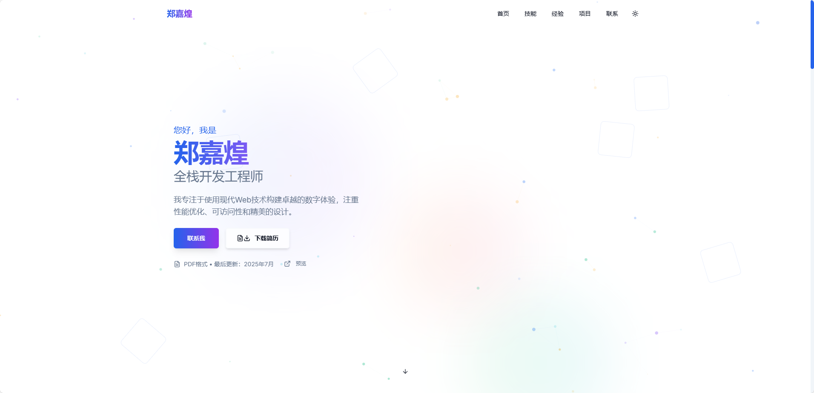
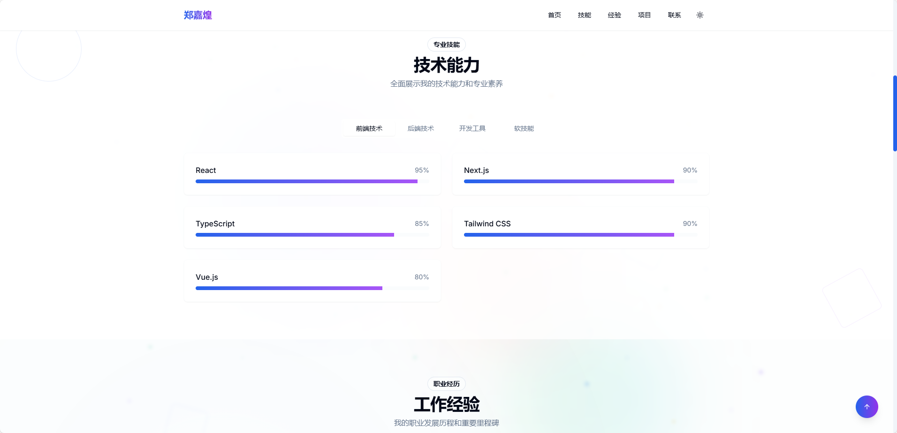
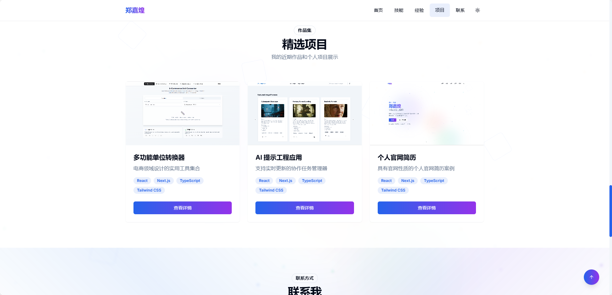
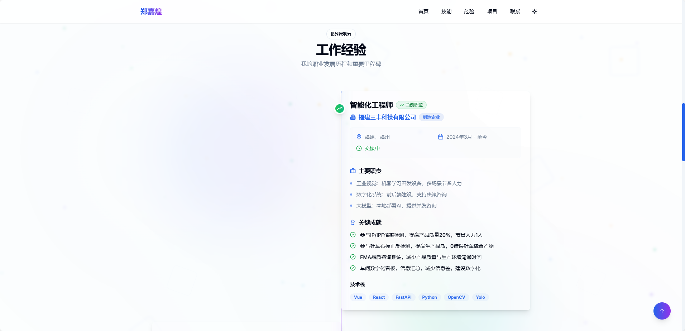
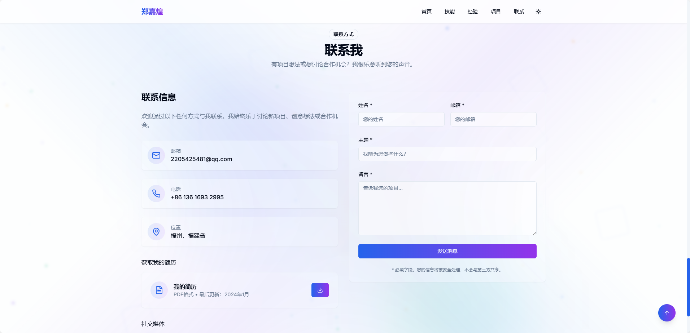

# 个人简历网站

这是一个使用 Next.js 和 Tailwind CSS 构建的现代化个人简历网站项目，支持服务器端渲染和响应式布局。

## 预览图

### 首页



### 技能



### 项目



### 经验



### 联系



## 核心亮点

### 🎨 设计特性

- ✅ 响应式布局：适配 PC/平板/手机等所有设备
- ✅ 现代化 UI 设计：采用卡片式布局与微交互动效
- ✅ 可访问性优化：符合 WCAG 2.1 AA 标准

### ⚙️ 技术架构

- ✅ 组件化开发：所有 UI 元素均封装为可复用组件
- ✅ TypeScript：提供完整的类型定义和安全检查
- ✅ 模块化 CSS：通过 Tailwind CSS 实现原子化样式管理

### 🚀 开发体验

- ✅ 快速原型开发：支持热重载和实时预览
- ✅ 可维护性强：清晰的代码结构和模块划分
- ✅ 持续集成：内置构建和部署流程

## 技术栈

- Next.js 14
- React 18
- TypeScript
- Tailwind CSS
- PostCSS
- pnpm (包管理器)

## 项目结构说明

- `/app` - Next.js 应用程序主目录
- `/components` - UI 组件和自定义组件
- `/contexts` - React 上下文，包括语言设置
- `/hooks` - 自定义 React 钩子
- `/services` - 后端服务接口，如汇率服务
- `/public` - 静态资源文件
- `/styles` - 全局样式定义

## 开发环境配置

### 前置要求

- Node.js 18.x 或更高版本
- pnpm (推荐) 或 npm, yarn

### 安装依赖

```bash
# 克隆项目
git clone https://github.com/Hanyeweiyang/resume-website.git
cd resume-website

# 使用pnpm安装依赖
pnpm install
```

### 开发命令

```bash
# 启动开发服务器
pnpm dev

# 构建生产版本
pnpm build

# 启动生产服务器
pnpm start

# 代码检查
pnpm lint
```

## 部署信息

项目已部署在 Vercel 平台：

**[在线查看个人简历](https://resume-website-alpha-lac.vercel.app/)**

## 留言邮件

配置站内发送后，联系表单通过 QQ 邮箱 SMTP 将留言发到 `2205425481@qq.com`。在 QQ 邮箱中启用 SMTP 并生成客户端授权码，再在本地 `.env.local` 或 Vercel 项目的环境变量中设置以下服务端配置。更新 Vercel 环境变量后需重新部署。

| 变量 | 用途 |
| --- | --- |
| `QQ_SMTP_AUTH_CODE` | QQ 邮箱生成的 SMTP 客户端授权码 |
| `UPSTASH_REDIS_REST_URL` | Upstash Redis 的 HTTPS REST 地址 |
| `UPSTASH_REDIS_REST_TOKEN` | 有写权限的 Upstash REST Token |
| `CONTACT_IP_HASH_SECRET` | 用 `openssl rand -hex 32` 生成的 IP 哈希密钥 |

同一公网 IP 共用滚动 24 小时的站内发送额度。Vercel 上使用平台提供的客户端 IP，Redis 只保存带密钥的 IP 摘要和限流记录。本地开发统一计为一个 IP。尚未配置站内发送时，联系区使用 Gmail 网页版或系统邮件客户端打开草稿，访客可在写信窗口发送。

## 许可证

本项目采用 MIT 许可证
